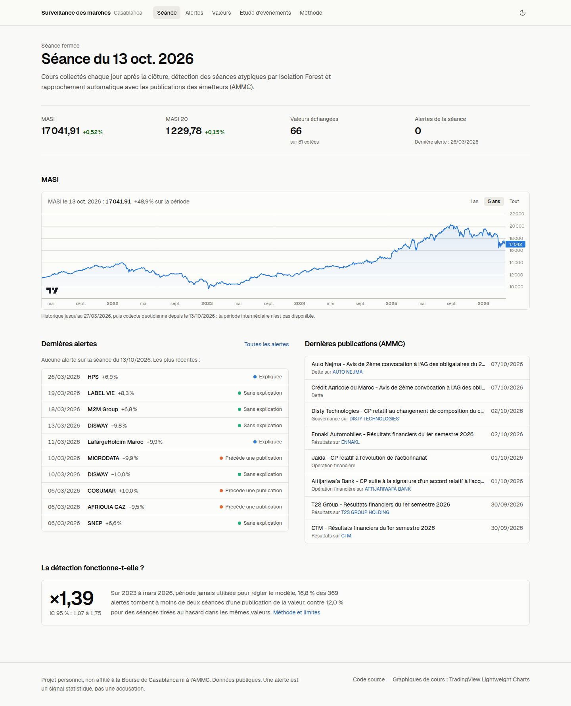
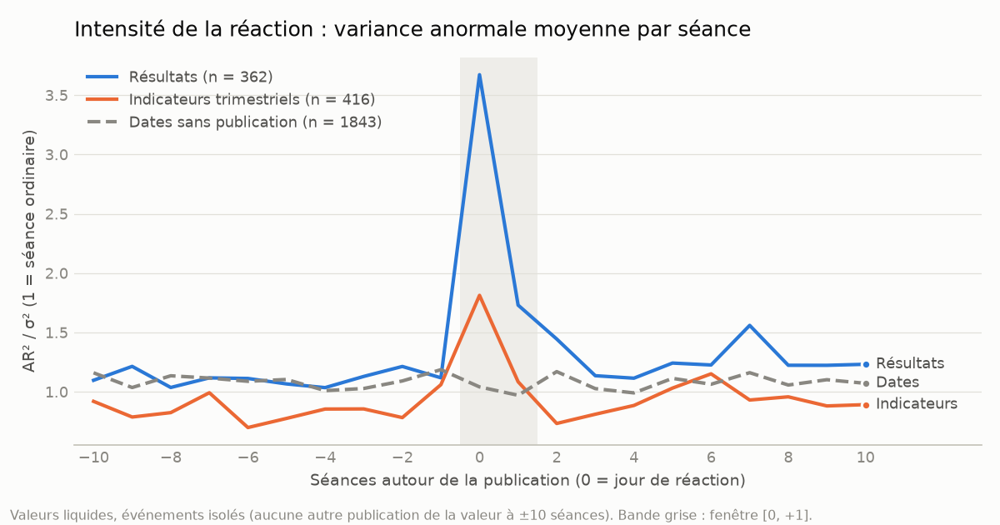
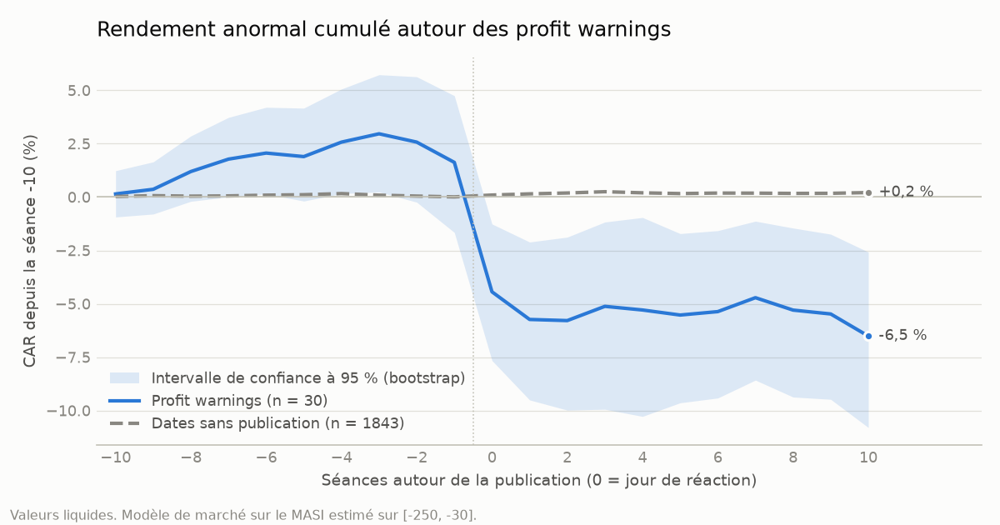
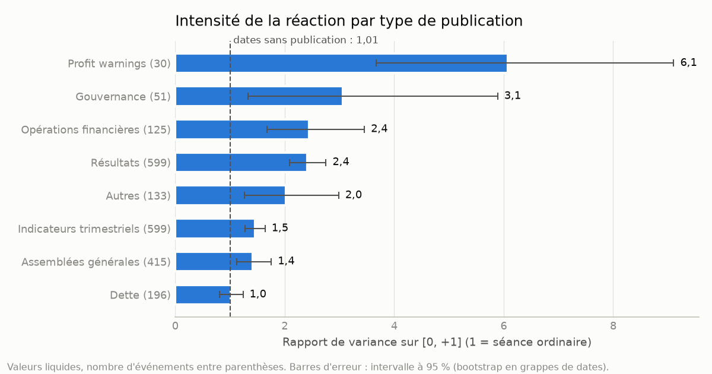
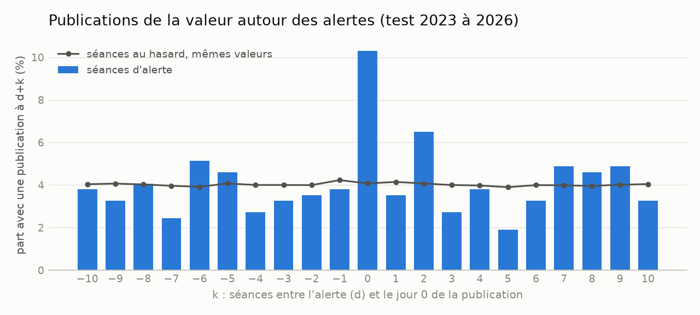
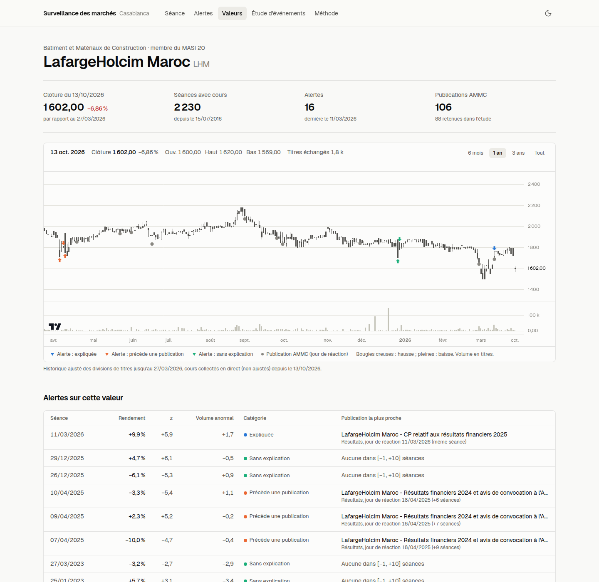
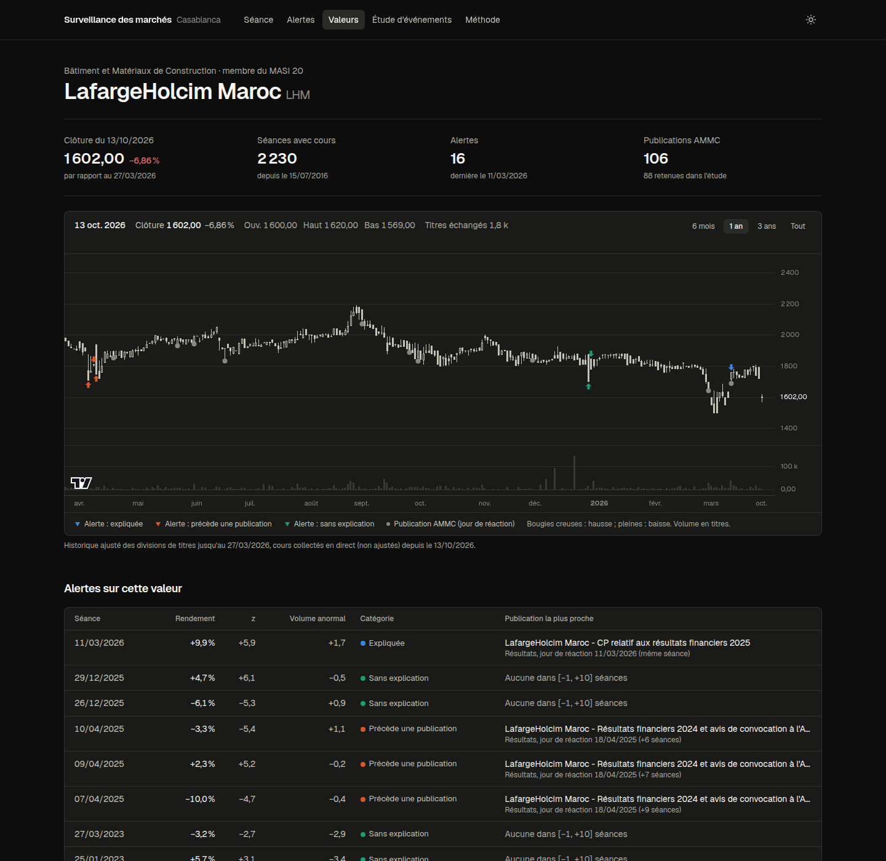
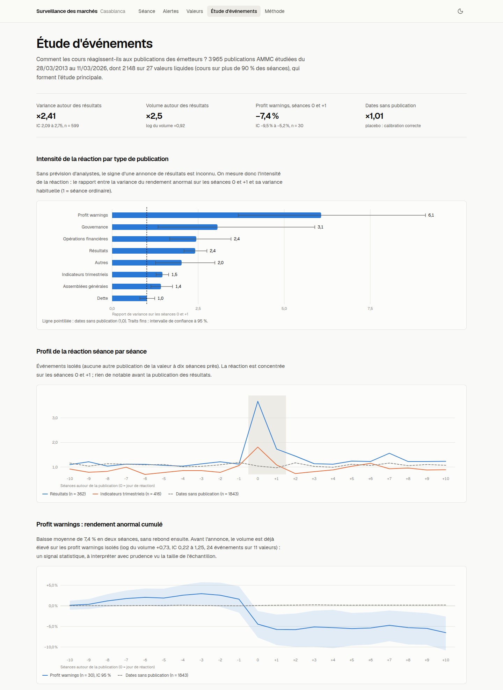
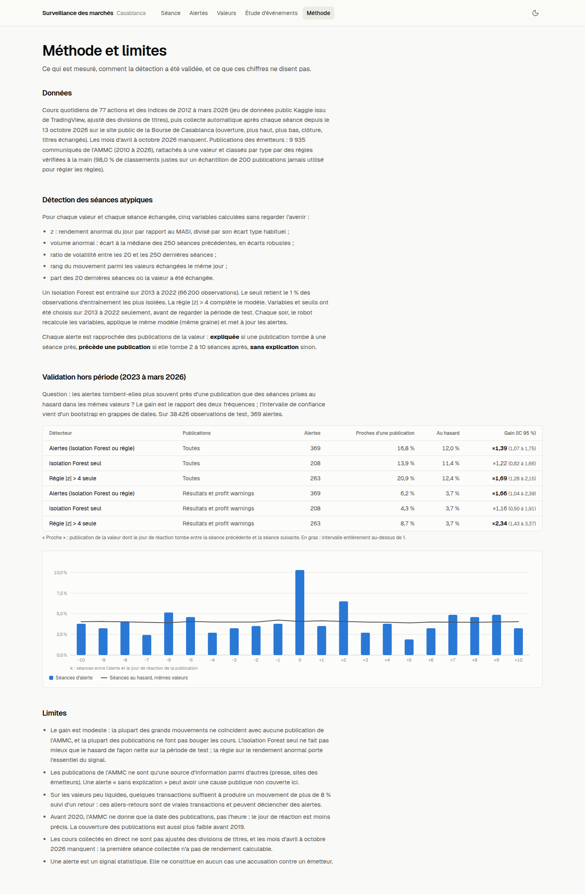

# Surveillance des marchés de la Bourse de Casablanca

**Tableau de bord en ligne : [bvc-surveillance.vercel.app](https://bvc-surveillance.vercel.app/)**



Deux volets :

1. **Étude d'événements** sur les publications des émetteurs (AMMC) et l'historique des cours depuis 2012 : rendements anormaux avant et après chaque annonce, par type d'annonce et par secteur.
2. **Surveillance quotidienne** : collecte des cours après chaque séance (GitHub Actions, PostgreSQL), détection des séances atypiques (Isolation Forest et règle statistique), rapprochement automatique avec les publications, tableau de bord en ligne.

Un mouvement repéré avant une publication est un **signal statistique**, jamais une accusation contre un émetteur.

**En bref.**
- Autour des publications de résultats, la variance des rendements anormaux est multipliée par 2,4 et le volume par 2,5 ; un profit warning fait baisser le cours de 7,4 % en moyenne en deux séances.
- Sur une période de test jamais utilisée pour régler la détection (2023 à mars 2026), les alertes tombent 1,39 fois plus souvent près d'une publication que des séances prises au hasard (IC 95 % : 1,07 à 1,75). Le gain est réel mais modeste, et il vient surtout de la règle sur le rendement anormal (détails plus bas).

## Données

| Source | Contenu | Accès |
|---|---|---|
| [casablanca-bourse.com](https://www.casablanca-bourse.com/) | cours des 81 valeurs (ouverture, plus haut, plus bas, clôture, volume), MASI, MASI 20, tops ; secteurs et composition du MASI 20 | page d'accueil et `/live-market/actions`, collectées chaque jour |
| [Kaggle, farihomar](https://www.kaggle.com/datasets/farihomar/moroccan-stocks-and-indices-historical-prices) (MIT, données TradingView) | OHLCV quotidiens, 77 actions et 32 indices, mars 2012 à mars 2026 | zip public |
| [AMMC](https://www.ammc.ma/fr/communiques-presse-emetteurs) | communiqués des émetteurs (date, émetteur, objet) | pages publiques |

## Résultats de l'étude d'événements

`python -m bvcsurv.etude && python -m bvcsurv.figures` (tableaux et figures dans `results/etude/`).

**Échantillon.** 7 817 publications AMMC rattachées à une valeur, 3 965 événements retenus de mars 2013 à mars 2026 (détail des rejets dans `results/etude/attrition.csv` : surtout des valeurs trop peu échangées pour estimer le modèle). Étude principale : 2 148 événements sur 27 valeurs liquides (cours présent sur plus de 90 % des séances).

**Méthode.** Modèle de marché sur le MASI estimé sur [−250, −30] ; rendements anormaux cumulés (CAR) sur [−10, −1], [0, +1] et [+2, +10]. Sans prévision d'analystes, on ne sait pas si un résultat est une bonne ou une mauvaise nouvelle : la moyenne signée tend vers zéro. L'intensité de la réaction se mesure donc par le **rapport de variance** (AR² / σ², 1 pour une séance ordinaire) et par le **volume anormal** (écart de log du nombre de titres échangés avec la période d'estimation : +0,92 ≈ volume multiplié par 2,5). Intervalles de confiance à 95 % par bootstrap en grappes de dates. La référence est un **placebo** : les mêmes mesures sur des dates tirées au hasard sans publication de la valeur.

| Type | Événements | CAR [0, +1] | IC 95 % | Rapport de variance [0, +1] | IC 95 % | Volume anormal [0, +1] |
|---|---:|---:|---|---:|---|---:|
| Résultats | 599 | −0,3 % | −0,7 à +0,1 | 2,41 | 2,09 à 2,75 | +0,92 |
| Profit warnings | 30 | −7,4 % | −9,5 à −5,2 | 6,07 | 3,67 à 9,11 | +1,95 |
| Indicateurs trimestriels | 599 | 0,0 % | −0,3 à +0,3 | 1,46 | 1,28 à 1,64 | +0,53 |
| Assemblées générales | 415 | 0,0 % | −0,3 à +0,3 | 1,42 | 1,13 à 1,76 | +0,33 |
| Opérations financières | 125 | +0,1 % | −0,8 à +0,9 | 2,45 | 1,68 à 3,46 | +0,44 |
| Dette | 196 | 0,0 % | −0,3 à +0,3 | 1,01 | 0,80 à 1,24 | +0,23 |
| Gouvernance | 51 | −0,2 % | −1,8 à +1,2 | 3,06 | 1,33 à 5,89 | +0,24 |
| Autres | 133 | +1,1 % | +0,5 à +1,7 | 2,02 | 1,26 à 2,99 | +0,18 |
| *Dates sans publication (placebo)* | 1 843 | +0,1 % | 0,0 à +0,3 | 1,01 | 0,93 à 1,09 | −0,02 |



**Lecture.**
- Les publications de **résultats** font bouger les cours : variance multipliée par 2,4 et volume par 2,5 sur [0, +1]. L'effet est net dans 6 groupes de secteurs sur 7 ; il est plus faible pour les banques (1,29, IC 0,92 à 1,77), qui sont de grandes capitalisations très suivies. L'intervalle est entièrement au-dessus de 1 pour 10 années sur 14. Le placebo reste à 1,01 : le modèle est bien calibré.
- Les **profit warnings** provoquent une baisse moyenne de 7,4 % en deux séances. La **dette** (émissions obligataires, assemblées d'obligataires) ne fait pas réagir l'action, ce qui est attendu.
- **Avant la publication** : sur les événements isolés (aucune autre publication de la valeur à ±10 séances), le volume avant les résultats ne s'écarte pas du placebo (+0,06, IC −0,08 à +0,21). Avant les profit warnings, il est plus élevé (+0,73, IC +0,22 à +1,25 ; 24 événements, 11 valeurs). C'est un **signal statistique** sur un petit échantillon, pas la preuve d'une fuite d'information ni une accusation contre un émetteur.





**Limites.**
- Avant 2020, l'AMMC ne donne que la date de publication : le jour 0 peut précéder d'une séance la vraie réaction, d'où la fenêtre [0, +1].
- La couverture AMMC est inégale (environ 300 publications par an jusqu'en 2018, environ 1 000 ensuite).
- Le jeu Kaggle ne contient que les valeurs cotées en 2026 (biais du survivant) et s'arrête au 27 mars 2026 ; la collecte quotidienne reprend au 13 octobre 2026.
- Les groupes de secteurs ne comptent que 1 à 8 valeurs liquides chacun (`results/etude/resultats_par_secteur.csv`).
- Le classement par type est automatique (98 % de justes sur un échantillon vérifié à la main).

## Détection des séances atypiques

`python -m bvcsurv.detection` (table `alerts` dans PostgreSQL, tableaux et figure dans `results/detection/`).

**Variables.** Une observation est une valeur un jour où elle a été échangée : 104 626 observations sur 63 valeurs, de 2013 à 2026. Chaque variable n'utilise que l'information disponible à la clôture du jour :

| Variable | Calcul |
|---|---|
| z | rendement anormal du jour (modèle de marché sur le MASI estimé sur [−250, −30], comme dans l'étude d'événements) divisé par l'écart type des résidus |
| volume anormal | log(1 + titres échangés) moins la médiane des 250 séances précédentes, divisé par l'écart absolu médian × 1,4826 |
| ratio de volatilité | log de l'écart type des rendements sur 20 séances rapporté à celui sur 250 séances |
| rang | rang du \|z\| du jour parmi les valeurs échangées le même jour (0 à 1) |
| part échangée | part des 20 dernières séances où la valeur a été échangée |

Sont exclus : les sauts de prix au-delà de la limite (`price_flags`), le lendemain d'un trou du calendrier et les estimations sur moins de 150 séances échangées.

**Modèle et règle.** Un Isolation Forest (300 arbres, 512 observations par arbre, graine fixe) est entraîné sur 2013 à 2022 ; le seuil retient le 1 % des observations d'entraînement les plus isolées. Une séance est en **alerte** si l'Isolation Forest la retient **ou** si |z| > 4. Une règle sur le volume seul a été essayée puis retirée : sur 2013 à 2022, un volume extrême n'était pas plus proche des publications que le hasard (gain 0,87). **Variables, seuils et règles ont tous été choisis sur 2013 à 2022, avant de regarder la période de test.** Résultat : 1 209 alertes (840 sur l'entraînement, 369 sur le test). Chaque soir, le robot recalcule les variables et applique le même modèle aux nouvelles séances.

**Catégories.** Chaque alerte (séance d) est rapprochée des publications de la valeur, avec le même jour de réaction que dans l'étude d'événements :
- **expliquée** : une publication tombe entre d−1 et d+1 ;
- **précède une publication** : une publication tombe entre d+2 et d+10 ;
- **sans explication** : aucune publication dans [d−1, d+10].

Sur les 369 alertes de test : 62 expliquées, 95 qui précèdent une publication, 212 sans explication. Pour les séances récentes, la catégorie peut changer quand de nouvelles publications arrivent.

**Validation hors période (2023 à mars 2026).** Question : les alertes tombent-elles plus souvent à moins de deux séances d'une publication ([d−1, d+1]) que des séances tirées au hasard dans les mêmes valeurs ? Le gain est le rapport des deux fréquences, avec un intervalle de confiance à 95 % par bootstrap en grappes de dates (`results/detection/validation.csv`).

| Détecteur | Publications | Alertes | Proches d'une publication | Au hasard | Gain | IC 95 % |
|---|---|---:|---:|---:|---:|---|
| **Alertes (Isolation Forest ou règle)** | toutes | 369 | 16,8 % | 12,0 % | **×1,39** | 1,07 à 1,75 |
| Isolation Forest seul | toutes | 208 | 13,9 % | 11,4 % | ×1,22 | 0,82 à 1,66 |
| Règle \|z\| > 4 seule | toutes | 263 | 20,9 % | 12,4 % | ×1,69 | 1,28 à 2,15 |
| **Alertes (Isolation Forest ou règle)** | résultats et profit warnings | 369 | 6,2 % | 3,7 % | **×1,66** | 1,04 à 2,39 |
| Isolation Forest seul | résultats et profit warnings | 208 | 4,3 % | 3,7 % | ×1,16 | 0,50 à 1,91 |
| Règle \|z\| > 4 seule | résultats et profit warnings | 263 | 8,7 % | 3,7 % | ×2,34 | 1,43 à 3,37 |



**Lecture.**
- Le jour même de l'alerte, 10,3 % des alertes coïncident avec une publication de la valeur, contre 4,1 % pour une séance au hasard (environ 2,5 fois plus). Ce pic était déjà visible sur 2013 à 2022.
- Sur toute la fenêtre [d−1, d+1], le gain est de 1,39 : **réel mais modeste**. Beaucoup de grands mouvements ont une cause qui n'apparaît pas dans les publications de l'AMMC (marché dans son ensemble, presse, valeurs peu liquides), et beaucoup de publications ne font pas bouger les cours.
- **L'Isolation Forest seul n'est pas significatif sur le test** (intervalle qui contient 1) : la règle sur le rendement anormal porte l'essentiel du signal. Le modèle est conservé parce qu'il a été choisi ainsi avant le test ; le régler à nouveau maintenant que le test a été regardé serait du surapprentissage. Les séances collectées depuis le 13 octobre 2026 forment un vrai test sur des données nouvelles.
- Les alertes « précèdent une publication » ne sont pas plus fréquentes qu'au hasard sur le test (gain 0,90 sur [d+2, d+10], IC 0,73 à 1,07) : la détection ne met pas en évidence de mouvement anticipé systématique.

## Tableau de bord

**[bvc-surveillance.vercel.app](https://bvc-surveillance.vercel.app/)** (code dans `dashboard/`).

| Page | Contenu |
|---|---|
| `/` | dernière séance (MASI, MASI 20, valeurs échangées), alertes et publications récentes, résultat de la validation |
| `/alertes` | toutes les alertes, filtres par année, valeur, catégorie et période (entraînement, test, direct) |
| `/valeurs` | les actions cotées, classées par secteur, avec l'appartenance au MASI 20 |
| `/valeurs/[symbole]` | chandeliers et volume, marqueurs des alertes et des publications, réactions passées, liste des publications |
| `/etude` | résultats de l'étude d'événements |
| `/methode` | méthode, validation complète et limites |



<details>
<summary>Autres captures : mode sombre, étude d'événements, méthode</summary>







</details>

**Technologies.** Next.js 16 (App Router, TypeScript), Tailwind CSS v4, shadcn/ui, TradingView Lightweight Charts (attribution en pied de page), mode clair et sombre, hébergé sur Vercel.

**Données.** Cours, publications et alertes sont lus dans PostgreSQL (Neon) côté serveur uniquement, avec un compte **en lecture seule** (`bvc_lecture`, droit SELECT seulement, voir `sql/lecture.sql`). Les résultats historiques (étude d'événements, validation) viennent de `dashboard/data/*.json`, produits par `python -m bvcsurv.export`. Les pages sont mises en cache et rafraîchies au plus une fois par heure : l'affichage est rapide et la base, qui se met en veille, est peu sollicitée. Chaque commit du robot sur `main` redéploie le site.

## Surveillance quotidienne

Le robot `.github/workflows/collecte.yml` tourne du lundi au vendredi à 16 h 30 et 18 h 30 UTC (GitHub peut décaler l'heure de lancement) : collecte des cours, contrôle des sauts de prix, trois dernières pages de publications AMMC, détection, puis commit de `data/live` et `data/ammc`. L'adresse de la base est un secret GitHub, jamais versionnée.

## Référentiels (`data/ref/`)

| Fichier | Contenu |
|---|---|
| `emetteurs_alias.csv` | écritures des émetteurs AMMC → ticker, ou émetteur non coté / sans historique (changements de nom datés, ex. Holcim Maroc avant et après 2016) |
| `types_validation.csv` | 200 publications tirées au hasard et classées à la main : le classement automatique par type en retrouve 196 (98,0 %) |
| `valeurs.csv` | 81 valeurs : symbole officiel, secteur, compartiment, nombre de titres, appartenance actuelle au MASI 20 |
| `ruptures_prix.csv` | variations au-delà de la limite de ±10 % par séance (cumulée sur les séances sans cotation), exclues des fenêtres d'événement |

L'historique Kaggle est déjà ajusté des divisions du nominal (aucun saut aux divisions de HPS en 2023 et de Sothema en 2021) ; son volume est exprimé en nombre de titres.

Le serveur de la Bourse n'envoie pas son certificat intermédiaire : il est fourni dans `certs/` et ajouté au magasin `certifi` (la vérification TLS reste active).

## Reproduire

Python 3.12 et PostgreSQL (par exemple un conteneur Docker local ou une base Neon gratuite).

```bash
uv venv && uv pip install -e ".[analysis,dev]"
cp .env.example .env              # renseigner DATABASE_URL (le fichier .env n'est jamais versionné)
python -m bvcsurv.kaggle          # historique des cours -> PostgreSQL
python -m bvcsurv.live            # cours du jour
python -m bvcsurv.ammc fetch      # historique des publications (reprise automatique)
python -m bvcsurv.ammc parse && python -m bvcsurv.ammc load   # avec ticker et type
python -m bvcsurv.valeurs fetch && python -m bvcsurv.valeurs load  # secteurs, MASI 20
python -m bvcsurv.qualite         # sauts de prix
python -m bvcsurv.etude && python -m bvcsurv.figures   # étude d'événements
python -m bvcsurv.detection       # détection, table alerts, results/detection/
python -m bvcsurv.export          # résultats historiques -> dashboard/data/*.json
pytest
```

Tableau de bord (Node.js 24) :

```bash
cd dashboard
cp .env.example .env.local        # adresse du compte en lecture seule (sql/lecture.sql)
npm install
npm run dev                       # http://localhost:3000
npm run lint && npm run build
```

## Limites

- Le gain de la détection est modeste : la plupart des grands mouvements ne coïncident avec aucune publication de l'AMMC, et la plupart des publications ne font pas bouger les cours. L'Isolation Forest seul ne fait pas mieux que le hasard de façon nette sur la période de test ; la règle sur le rendement anormal porte l'essentiel du signal.
- Les publications de l'AMMC ne sont qu'une source d'information parmi d'autres (presse, sites des émetteurs). Une alerte « sans explication » peut avoir une cause publique non couverte ici.
- Sur les valeurs peu liquides, quelques transactions suffisent à produire un mouvement de plus de 8 % suivi d'un retour : ces allers-retours sont de vraies transactions et peuvent déclencher des alertes.
- Avant 2020, l'AMMC ne donne que la date des publications, pas l'heure : le jour de réaction est moins précis. La couverture des publications est aussi plus faible avant 2019.
- Les cours collectés en direct ne sont pas ajustés des divisions de titres, et les mois d'avril à octobre 2026 manquent : la première séance collectée (13 octobre 2026) n'a pas de rendement calculable.
- Une alerte est un signal statistique. Elle ne constitue en aucun cas une accusation contre un émetteur.

## Avertissement

Projet personnel, **non affilié** à la Bourse de Casablanca, à l'AMMC, à Kaggle ni à TradingView. Toutes les données utilisées sont publiques. Rien ici ne constitue un conseil en investissement.

## Licence

MIT. Les données restent la propriété de leurs sources respectives.
